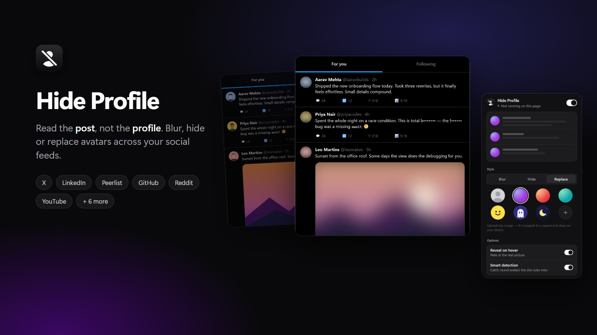
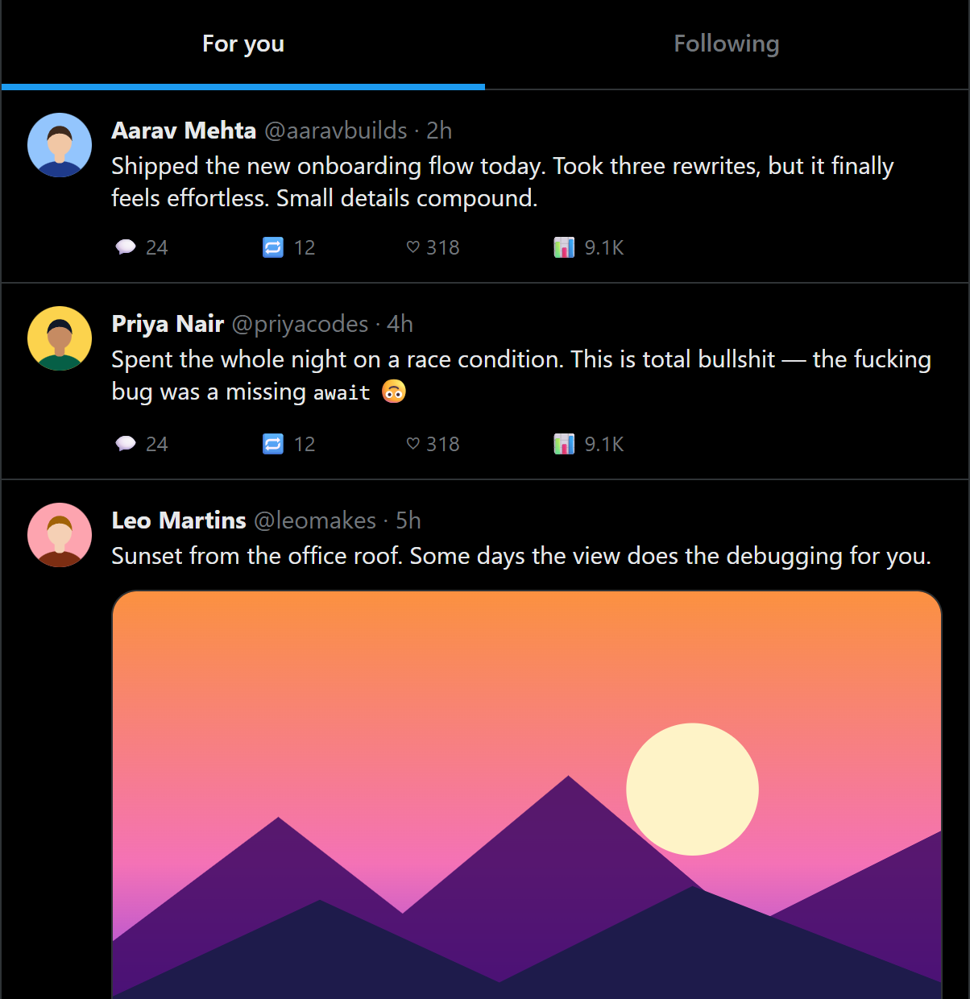
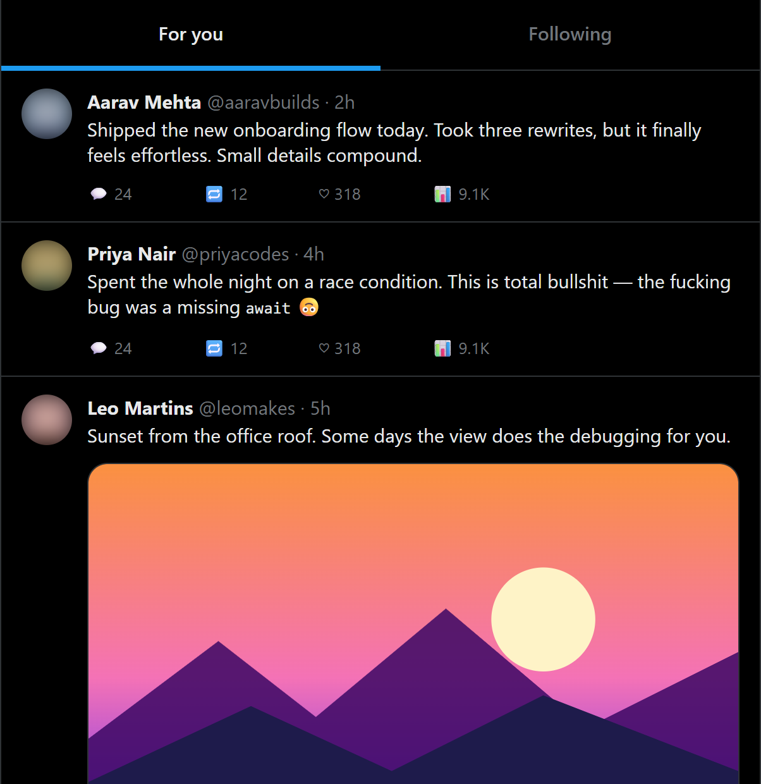
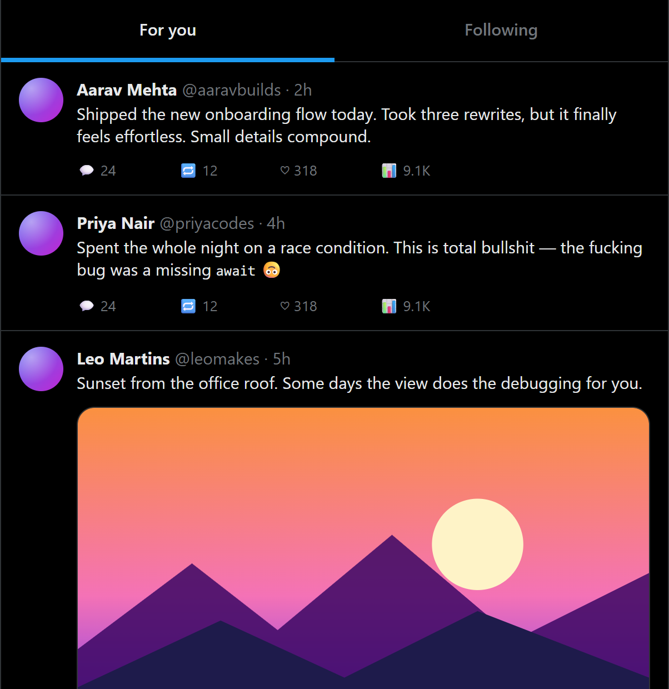
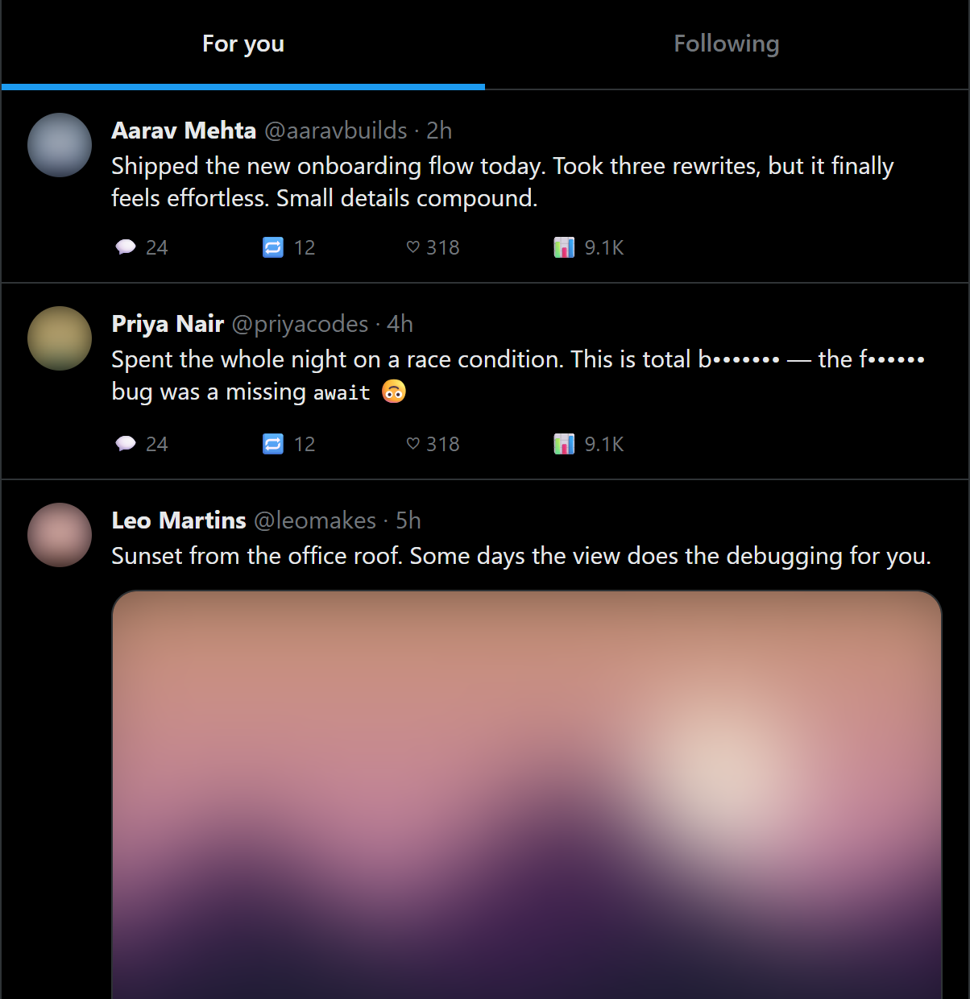
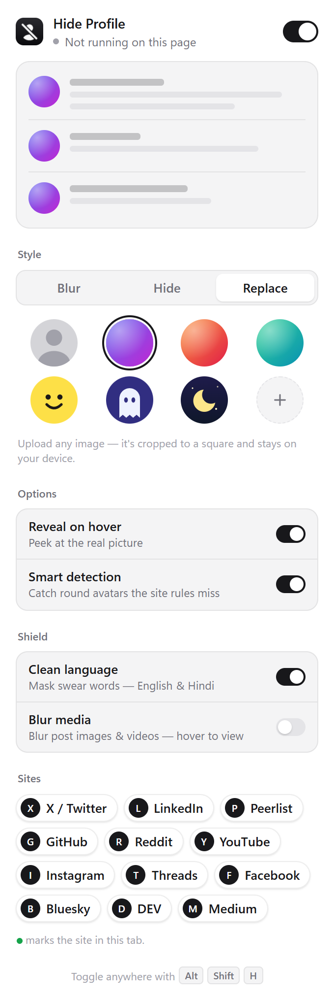
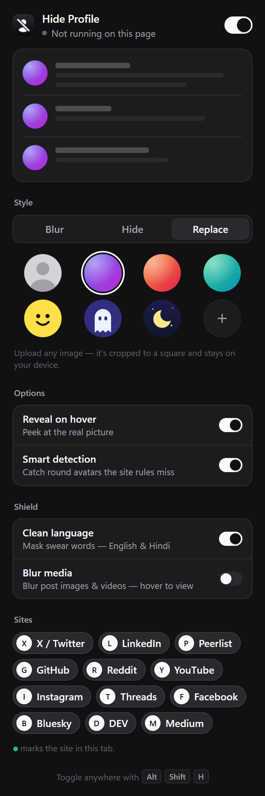

<p align="center">
  
</p>

<h1 align="center">Hide Profile</h1>

<p align="center">
  <b>Read the post, not the profile.</b><br>
  A tiny Chrome extension that blurs, hides or replaces profile pictures across your social feeds,<br>
  with optional swear-word masking and media blur.
</p>

<p align="center">
  
  
  
  
</p>

---

## Why

Faces anchor how we read. A post from someone attractive, famous or familiar reads differently from the same words under a stranger's photo. Hide Profile takes the faces out of the feed so the words and ideas stand on their own. You can also keep your feed calmer and family-friendly.

## Features

| | |
|---|---|
| **Three styles** | **Blur** · **Hide** (neutral placeholder) · **Replace** with one of 7 preset avatars or your own image |
| **Reveal on hover** | Peek at the real picture when you want to |
| **Smart detection** | Catches small, round avatars the per-site rules miss, so redesigns keep working |
| **Clean language** | Masks swear words in English, Hinglish and Devanagari (`f•••ing`, `b•••••••`) and catches look-alikes such as `f*ck` and `sh1t` |
| **Blur media** | Blurs post images, thumbnails and videos until you hover |
| **Hide follower counts** | Blurs follower, following, subscriber and connection counts so takes stand on their own |
| **Reveal one post** | <kbd>Alt</kbd>+<kbd>Shift</kbd>+<kbd>R</kbd> reveals just the focused post (or the one under your pointer); press again to hide it. Works with keyboard feed navigation such as <kbd>J</kbd>/<kbd>K</kbd> on X |
| **Per-site control** | Turn each site on or off, or use the global switch. <kbd>Alt</kbd>+<kbd>Shift</kbd>+<kbd>H</kbd> toggles everything |
| **Light & dark** | The popup follows your system theme |

**Supported sites:** X / Twitter · LinkedIn · Peerlist · GitHub · Reddit · YouTube · Instagram · Threads · Facebook · Bluesky · DEV · Medium

## Screenshots

| Before | Blur | Replace |
|---|---|---|
|  |  |  |

| Shield: clean language + blur media | Popup (light) | Popup (dark) |
|---|---|---|
|  |  |  |

## Install

**From source (unpacked):**

1. Download or clone this repo:
   ```bash
   git clone https://github.com/imnakul/hide-profile.git
   ```
2. Open `chrome://extensions` (or `edge://extensions`, `brave://extensions`)
3. Turn on **Developer mode**
4. Click **Load unpacked** and select the `hide-profile` folder
5. Pin the extension and open the popup

It works in any Chromium browser: Chrome, Edge, Brave, Arc, Opera and Vivaldi.

## Privacy

- **No network requests.** Nothing leaves your browser, and there is no analytics or telemetry.
- **Only `storage` permission.** It runs only on the sites listed above.
- Settings and your uploaded avatar stay in `chrome.storage.local` on your device.

## How it works

The content script (`src/content.js`) runs at `document_start` on supported sites:

1. **Site rules** in `src/shared.js` → `SITES` mark known avatars by selector, e.g. `img[src*="pbs.twimg.com/profile_images"]`.
2. **Smart detection** checks the remaining ``s after layout but before paint, inside `requestAnimationFrame`. An image counts as an avatar if it is 18–200px, square, and clipped to a circle on itself or on a same-size wrapper. With **Blur media** on, larger images are marked as media instead.
3. Marked elements get a `data-hp` / `data-hp-media` attribute. One injected stylesheet does the rest:
   - Blur uses `filter: blur()`
   - Hide and Replace use `content: url(…)` on ``, and `background-image` for avatars painted as backgrounds (X)
4. **Clean language** walks text nodes once and masks matches in place, with one precompiled regex. Editable fields are never touched, and turning it off restores the original text.
5. **Hide follower counts** finds short elements whose whole text reads like `1.2K followers` or `500+ connections`, including when the number and label sit in separate spans, and marks them with `data-hp-count`.
6. **Reveal one post** sets `data-hp-reveal` on the closest post container (`article`, Reddit/YouTube/LinkedIn post elements); every rule skips elements inside it. Both shortcuts can be changed at `chrome://extensions/shortcuts`.
7. A `MutationObserver` keeps up with infinite scroll and SPA navigation. Settings apply live without a reload.

The page's markup is never rewritten, and avatars are styled before they paint, so there's no flash of the real image.

### Limitations

These are deliberately simple, low-cost filters, not AI classifiers:

- Word masking is list-based. It catches common words and look-alikes, but not every spelling or context.
- **Blur media** blurs *all* sizeable images and videos. It doesn't judge what they show.
- **Hide follower counts** matches English labels only.
- Sites change their markup often. If something slips through, please [open an issue](../../issues) or a PR (see below).

## Contributing

### Add a site

Add an entry to `SITES` in [`src/shared.js`](src/shared.js), and add its host to `content_scripts.matches` in [`manifest.json`](manifest.json):

```js
{ id: 'mastodon', name: 'Mastodon', hosts: ['mastodon.social'], img: ['img.account__avatar'] }
```

| Key | Use for |
|---|---|
| `img` | `` avatars |
| `bg` | Elements painting the avatar as a `background-image` |
| `media` | Post-media containers to blur as a whole |
| `svg: true` | Sites that draw avatars with `<svg><image>` |

### Add words

Add a stem to `WORDS` in [`src/shared.js`](src/shared.js). Anything after the stem matches too (`fuck` → `fucking`), and vowels match common look-alikes automatically.

### Project structure

```
hide-profile/
├── manifest.json
├── src/
│   ├── shared.js        # sites, presets, word list, defaults
│   ├── content.js       # detection + styling, runs on supported sites
│   └── background.js    # badge + keyboard shortcut
├── popup/               # settings UI
├── icons/               # generated by scripts/make-icons.mjs
└── docs/                # screenshots
```

Run `node scripts/make-icons.mjs` to regenerate the icons. It needs no dependencies.

## License

[MIT](LICENSE)
